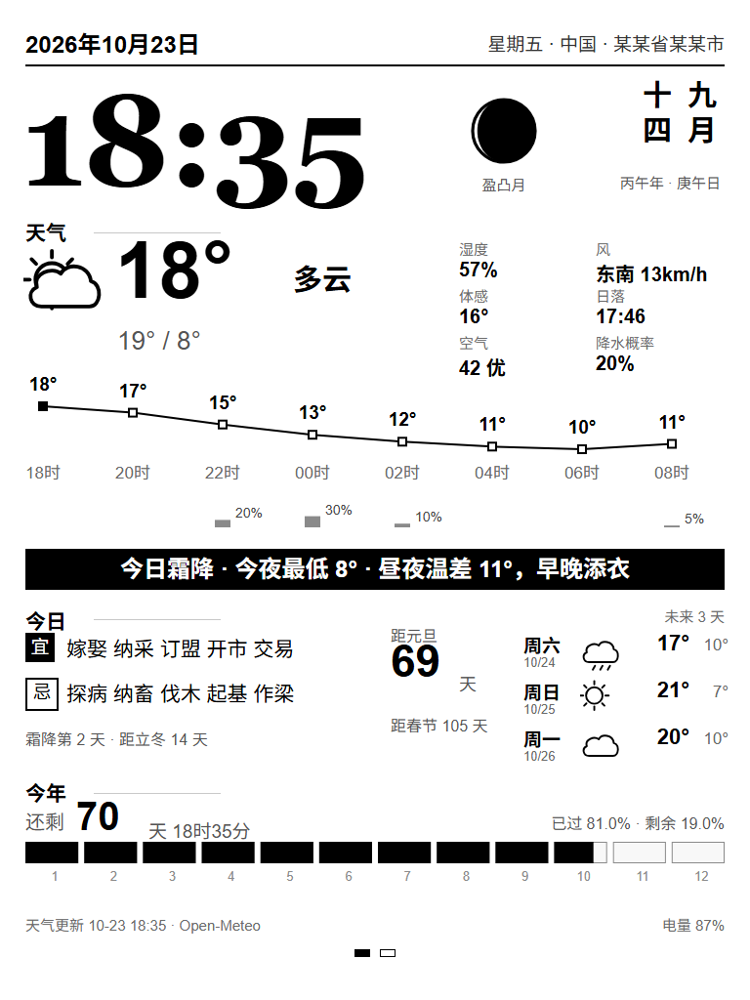

# Kindle 天气 & 留言板

**中文** · [English](README.en.md)

把一台吃灰的 Kindle（墨水屏）改造成**常显的天气 + 家庭留言板**：白天当桌面摆件看天气，家人用手机扫码就能往屏幕上推文字和图片。

整套东西完全跑在 Kindle 本机上，**不需要电脑常开、不需要树莓派、不需要任何服务器**。




## 它长什么样

**第一页 · 天气**
- 大时钟 + 日期 / 星期 / 地址
- 月相圆盘 + 竖排农历 + 干支
- 当前温度、天气图标、体感、今日高低温
- 逐时温度折线（2 小时一格）+ 降水概率柱
- 湿度 / 风 / 日落 / 空气质量 / 降水概率
- 今日黄历宜忌、距元旦 / 春节天数、未来 3 天预报
- 全年进度条（12 个月分段，当前月显示月内进度）

**第二页 · 留言**（点屏幕切换）
- 手机推送的文字 / 图片通知，最多显示最近 8 条，新的在最上面
- 二维码：手机扫码直接打开推送页面
- 底部背光滑杆：0（关）到 100%

## 特性

- **零外部依赖**：天气来自 Open-Meteo（免 API key），推送走 ntfy.sh 的公共实例，都是 HTTP
- **纯本地渲染**：页面连同 417 KB 的农历库一起内联成一个 HTML，从 `file://` 打开，不依赖任何本地服务器
- **20 秒级推送**：留言轮询 20 秒一次；页面原地更新，不闪屏、不跳页
- **真正全屏**：去掉了浏览器地址栏和工具栏，看起来像原生应用
- **背光可调**：点滑杆直接调硬件背光（`lipc-set-prop`），不是靠调暗画面
- **可复原**：动手前先整盘备份，随时能退回原系统

## 工作原理

```
┌─────────────┐   HTTP (wget)   ┌──────────────┐
│ Open-Meteo  │◄────────────────│              │
│  ntfy.sh    │                 │   frame.sh   │  每 20 秒：
└─────────────┘                 │  (设备端守护) │  抓数据 → 写 www/data.js
                                └──────┬───────┘
                                       │ 写文件
                                ┌──────▼───────┐
                                │ www/data.js  │
                                └──────┬───────┘
                                       │ <script src="data.js">
                                ┌──────▼───────┐
                                │  index.html  │  每 20 秒原地重新读一次
                                │ (QtWebKit)   │  只重绘变化的数字
                                └──────┬───────┘
                                       │
                                ┌──────▼───────┐
                                │ touchd.sh    │  读 /dev/input/event0
                                │              │  → 背光 lipc
                                └──────────────┘
```

为什么是「浏览器 + 本地文件」而不是更"高级"的方案：

- 越狱后的 Kindle 只给你一个 **QtWebKit 4.8 浏览器**和一套 busybox，**没有 httpd、没有 nc 监听、没有 python**，想在设备上跑个本地 Web 服务是做不到的
- QtWebKit 打开 `file://` 页面时**禁止 XHR 跨到远程 http**，所以不能让页面自己去抓接口
- 但同目录的 `<script src="data.js">` 是允许的 —— 于是让 shell 把 JSON 包成 `window.DATA = {...}` 写进 `data.js`，页面每 20 秒重新插一次 `<script>` 就能原地换数据，不重载页面

## 快速开始

详细步骤见 **[docs/INSTALL.md](docs/INSTALL.md)**，配置见 **[docs/CONFIG.md](docs/CONFIG.md)**，踩过的坑见 **[docs/TROUBLESHOOTING.md](docs/TROUBLESHOOTING.md)**。

最短路径：

```bash
# 1. 改配置（位置 + 推送主题）
vi device/config.sh

# 2. 构建页面（把农历库内联 + 生成二维码）
python -m pip install qrcode
python tools/build.py

# 3. 拷到 Kindle（仅这 4 个文件）
#    device/config.sh      -> /mnt/us/frame/config.sh
#    device/frame.sh       -> /mnt/us/frame/frame.sh
#    device/touchd.sh      -> /mnt/us/frame/touchd.sh
#    device/www/index.html -> /mnt/us/frame/www/index.html

# 4. 装开机自启（需越狱，root 下执行）
mntroot rw
cp device/S99frame /etc/rcS.d/S99frame
chmod +x /etc/rcS.d/S99frame
mntroot ro

# 5. 拔线重启
```

想在电脑上先看效果（不用 Kindle）：

```bash
python tools/sample_data.py
# 然后浏览器打开 device/www/index.html
```

## 目录结构

```
device/
  config.sh          唯一需要改的配置文件（位置 / 主题 / 刷新节奏 / 背光档位）
  frame.sh           设备端守护进程：抓数据、拼 data.js、看门狗、重启页面
  touchd.sh          触摸守护：读 event0 → 调背光
  S99frame           开机自启脚本
  www/index.html     构建产物（被拷到设备）
src/
  dashboard.html     页面源码（含 __LUNAR__ / __QR__ / __TOPIC__ 占位符）
tools/
  build.py           构建：内联农历库 + 生成二维码 → device/www/index.html
  sample_data.py     造假数据用于本机预览
  vendor/lunar.js    农历库（lunar-javascript 1.6.12）
docs/
  INSTALL.md         部署步骤（含越狱）
  CONFIG.md          改位置 / 改主题 / 改节奏
  TROUBLESHOOTING.md 已知坑与排查
```

## 适配机型

在 **Kindle Paperwhite 1（2012，固件 5.4.4.2）** 上完整实测。

其他 5.x 机型（PW2 / KT / K5）理论可用，需要改三个地方：

| 需要确认的 | 怎么确认 |
|---|---|
| 屏幕分辨率 | `cat /sys/class/graphics/fb0/virtual_size`，然后改 `src/dashboard.html` 里的 768×1024 与 `@media` 无关的绝对坐标 |
| 背光档位上限 | 试 `lipc-set-prop com.lab126.powerd flIntensity <N>`，改 `config.sh` 的 `BRIGHT_MAX` |
| 全屏配置 | 看 `/opt/var/local/mesquite/browser/config.xml` 是否存在（PW1 有） |

没有背光的机型（K4/K5）把 `touchd.sh` 里调背光那段去掉即可。

## 已知限制

- **插上数据线 = 设备冻结**。USB 模式会停掉整个系统，所以调试只能是「拔线跑 → 插线读日志 → 重启再跑」
- **每次插拔后必须重启**。`/mnt/us` 是 `fuse.fsp`，插拔一次后已运行进程的文件句柄全部失效
- 天气和农历都是离线算不了的（农历能算，天气不能），所以**必须联网**，WiFi 断了只会保留最后一次数据
- 刷新是整页重绘级别的墨水瓶刷新，看久了会有一点残影；长时间看建议关背光

## 致谢

- [Open-Meteo](https://open-meteo.com/) —— 免 key 的天气 / 空气质量 API，还支持 HTTP
- [ntfy.sh](https://ntfy.sh/) —— 免注册的推送服务，手机端有 App，也可以直接用网页发
- [lunar-javascript](https://github.com/6tail/lunar-javascript)（MIT）—— 农历 / 节气 / 宜忌
- [kylemccreery/kindle-dash](https://github.com/kylemccreery/kindle-dash) —— 同型号 PW1 上的 kiosk 实践，全屏配置的思路来自它
- [kindlemodding.org](https://kindlemodding.org/) —— 越狱流程

## 许可

MIT，见 [LICENSE](LICENSE)。
